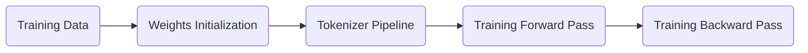

  
***  
  
GPT Training Process via Transformer ([State of GPT](https://karpathy.ai/)) &nbsp;&nbsp;&nbsp;&nbsp;&nbsp;[[>>>]](/docs/llm-fine-tune-sft/#whereami)

***  
## Glance
- Learnable weight that a model only have one:

    | Component | Weight | Shape | 
    |:----:|:----:|:----:|
    | Token Embedding | $W_E$ | [voca, d] |
    | Final RMSNorm | $γ_{final}$ | [d]|
    | LM Head | $W_{LM}$| [voca, d] |
 

- Learnable weights that each layer contains one ( N layers )  

    | Component | Weight | Shape | 
    |:----:|:----:|:----:|
    | RMSNorm1 | $γ_1$ | [d] |
    | Attention | $W_Q$ | [d, d]|
    | Attention | $W_K$ | [d, d] |
    | Attention | $W_V$ | [d, d] |
    | Attention | $W_O$ | [d, d] |
    | RMSNorm2  | $γ_2$| [d] |
    | SwiGLU | $W_{gate}$| [d, $d_{ff}$] |
    | SwiGLU | $W_{up}$| [d, $d_{ff}$] |
    | SwiGLU | $W_{down}$| [$d_{ff}$, d] |
    
- AdamW (Optimizer) 
  > AdamW needs to store each leanable weights's first moment and second moment for optimizing the weights updating direction and length. 

    $$
    \underbrace{mn}_{W_{gradient}}+\underbrace{mn}_{M_{1st moment}}+\underbrace{mn}_{V_{2nd moment}}=3mn  
    $$   
      
     e.g. a 7B module's pre-training needs at least 58GB GPU:
  - 14GB for trainable parameters
  - 42GB for Adam weight gradients and optimizer states 
  - 2GB for activations  

